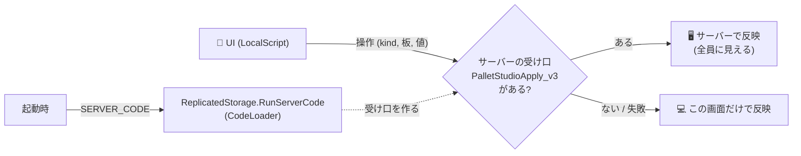

<div align="center">

# 🎨 PALLET STUDIO

**板 (PalletLightBrown) を自由にカスタマイズできる、Roblox 用のきれいな UI**

色・素材・プリセット・発光・レインボー・キラキラまで、全部ひとつのウィンドウでできます。


`make by aino` ✦

</div>

---

## 📚 目次

- [特徴](#-特徴)
- [クイックスタート](#-クイックスタート)
- [画面の見かた](#-画面の見かた)
- [機能一覧](#-機能一覧)
- [プリセット一覧](#-プリセット一覧)
- [素材一覧](#-素材一覧)
- [保存と永久保存](#-保存と永久保存)
- [しくみ](#-しくみ)
- [カスタマイズ](#-カスタマイズ)
- [よくある質問](#-よくある質問)
- [ファイル構成](#-ファイル構成)

---

## ✨ 特徴

| | |
|---|---|
| 🪶 **1ファイルで完結** | `hello.lua` ひとつだけで UI・処理・アニメーションが全部動きます |
| 🔢 **自分の板だけを検出** | Workspace の `<自分の@ID>SpawnedInToys` フォルダの直下にある板だけを「板1・板2…」と並べます。ほかの人の板は出ません。サーバー側も同じ条件の板しか受け付けません |
| 🏠 **ホーム画面** | アイコン・@ID・板の検出状況・サーバー連携・FPS / Ping をひと目で |
| 🌈 **グラデーション** | 2〜3色を板の向きに沿って混ぜる。おすすめ10種、ストライプ、**色が流れるアニメ**も |
| 💫 **なめらかな動き** | レインボー・明滅・流れるグラデは、各自の画面で毎フレーム動かすので、カクつかずにぬるぬる動きます(サーバー時刻でそろえるので、見ている人どうしで同じ動き) |
| 👁 **プレビュー & ヘルプ** | 3Dモデルで見た目を試してから「メイン保存」でプリセット化。各機能の説明はヘルプ窓で |
| 🧊 **ガラス風デザイン** | 半透明パネル、動くグラデーション、ふわふわ動く背景の玉 |
| 🎛 **細かく調整できる** | HSV・RGB・16進数、反射・透明度・色ムラなどをスライダーで |
| 🌈 **エフェクト** | 毎フレーム更新のなめらかなレインボー、キラキラ、発光、縁取り |
| 🚀 **軽量化** | マップの影・ライト・エフェクトなどを1項目ずつ安全にOFF。OFFで元に戻ります |
| 🎨 **UI を自分好みに** | テーマ色8種、背景アニメ8種(宇宙・雪・桜…)、透明度・大きさを調整できます |
| 📌 **永久保存** | 作った見た目を覚えておいて、これから出す板に自動で反映 |
| ⚡ **出現がカクつかない** | 色・素材・反射は板が出た瞬間に付き、重いグラデ/ツヤの重ね貼りは1フレームに数ミリ秒ずつ作ります(約0.05秒で完成)。小さな面には貼らず、作った面は中身だけ書き換えるので軽くてちらつきません |
| 🔁 **サーバー / ローカル両対応** | サーバー側の受け口があれば全員に、無ければ自分の画面だけに反映 |
| 📱 **スマホ専用レイアウト** | スマホでは縦長ウィンドウ・アイコンだけのタブ・大きめのスライダーとスイッチに自動で切り替え。画面の回転にも追従します |

---

## 🚀 クイックスタート

1. `hello.lua` の中身をコピーします。
2. Roblox Studio で **`StarterPlayer` › `StarterPlayerScripts`** に **LocalScript** を作り、貼り付けます。
3. ▶ Play を押すと、右下に `make by aino` のクレジットが出ます。
4. クレジットが消えると出てくる **🎨 丸いボタン** を押すとウィンドウが開きます(PC は左下、スマホは移動・ジャンプボタンを避けて右上)。
5. 板を出して、下のチップで選んで、好きなだけいじってください。

> [!TIP]
> 🎨 ボタンとウィンドウの上のバーは **ドラッグで動かせます**。動かさずに離せば普通のクリックになります。

---

## 🖼 画面の見かた

```
┌──────────────────────────────────────────────────────────────┐
│  PALLET STUDIO                         [選択中: 板1]  [–] [✕] │ ← 上のバー (ドラッグで移動)
│  板をカスタマイズ                                              │
├────────────┬─────────────────────────────────────────────────┤
│ 🏠  ホーム  │                                                 │
│ 🎨  色      │                                                 │
│ 🧱  素材    │                                                 │
│ ✨  プリセット│            選んだページの中身                    │
│ 💎  質感    │           (スクロールできます)                   │
│ 💡  光      │                                                 │
│ 🌈  効果    │                                                 │
│ ⚙️  その他  │                                                 │
├────────────┴─────────────────────────────────────────────────┤
│ [板1] [板2] [板3] …        [📌 永久保存] [↺ 元に戻す] [💾 保存] │ ← 下のバー
└──────────────────────────────────────────────────────────────┘
```

- **選んでいる板** は青い枠で光ります(選んだ直後と、変更したあと)。
- **💾 保存** は、何か変更したときだけ横から出てきます。

---

## 🧰 機能一覧

### 🏠 ホーム
| 項目 | 内容 |
|---|---|
| プロフィール | アイコン・表示名・@ID・UserId |
| 板の検出 | 見るフォルダ名(`<@ID>SpawnedInToys`) |
| 👁 プレビュー | 左に小さな窓が開き、**ふつうの見た目の板の3Dモデル** がゆっくり回ります。本体で色や素材を変えると **プレビューの板だけ** が変わります(本物の板・サーバーには送りません)。ドラッグで360度まわせます(さわっている間と、その後10秒は自動回転が止まります)。閉じると本体のスライダー/ボタンは初期位置に戻ります |
| 💾 メイン保存 | プレビュー中の見た目を「プリセット1・2…」として保存。左のページ一覧の「その他」の下にボタンが出て、押すと選んでいる板が一瞬でその見た目になります |
| ❓ ヘルプ | 別の窓が開き、各ページ → 各機能の説明を読めます(閉じると元の画面に戻ります) |

> [!NOTE]
> プレビューの窓(ViewportFrame)には重ね貼り・粒・ライト・縁取りが出せないので、薄い板を敷きつめる・窓のふちを光らせる・2Dの粒を出す などで近い見た目を再現しています。

### 🎨 色
| 項目 | 内容 |
|---|---|
| カラーパレット | よく使う 24 色をワンタップで |
| HSV | 色相・彩度・明度のスライダー(色相はレインボーのバー) |
| RGB | 赤・緑・青を 0〜1 で調整 |
| 16進数 | `#RRGGBB` を入力して「適用」 |
| 🌈 グラデーション | 色A →(色C)→ 色B を板の向き(X / Y / Z)に沿って混ぜる。おすすめ10種(夕焼け・海・オーロラ…)、反転・中間の位置・ストライプ(2〜8本)・なめらか塗り・**流れるアニメ(速さ調整)**。見本の帯つき |

### 🧱 素材
| 項目 | 内容 |
|---|---|
| 素材カード(152種) | Roblox の素材に、色や反射の違う「オーク・チェリー・ラピス…」のような種類を足した 152 種。押すだけでその素材らしい見た目になり、元のテクスチャも外れます。カードはページを初めて開いた時に少しずつ作ります |
| 検索・分類 | 名前で検索、分類で絞り込み |
| お気に入り / 最近 | ☆ でお気に入りに入れる・最近使った素材から選ぶ(この画面だけ。保存はしません) |
| 素材の入れ方 | いまの色を残す / 素材の色にする / 素材だけ(色も光もそのまま) |
| 🎲 ランダム | 表示中の素材からランダムに1つ |
| 🎭 ツートン(16種) | 板の一部だけ別の素材にします |

### ✨ プリセット
| 項目 | 内容 |
|---|---|
| 🎲 おまかせスタイル | 素材・ツヤ・空・光の走り・角・色/グラデ・光・明滅・効果をぜんぶランダムに決める(スライダーの表示も合わせます) |
| 📋 ほかの板にコピー | 選んでいる板の見た目を、ほかの全部の板にまとめて付ける |
| ✨ プリセット(105種) | 色・素材・ツヤ・光・動き・効果を一式で。基本の18種は[一覧](#-プリセット一覧)に |
| 入れ方(3種) | **ぜんぶ**(前のプリセットを全部置きかえ) / **見た目だけ**(色・素材・ツヤ) / **光と効果だけ** |
| 色違い / 前へ・次へ / ランダム | 色相をずらして色違いに、となりのプリセットへ順に切り替え、ランダムに1つ |
| 全部の板に同時に反映 | ON の間は、どの操作も自分の全部の板にまとめて付きます(この画面だけの設定) |

### 💎 質感
| 項目 | 範囲 |
|---|---|
| 質感のセット(38種) | 🪞鏡面ミラー · 💧ウェット · 💎ダイヤ · 🧪さびてボロボロ などを押すだけで。**素材・色はそのまま** で、ツヤ・映り込み・光の走り・角・経年を一式で切り替え |
| 反射・ツヤ | 0 〜 1。マット / ツヤ / ミラーのワンタッチ切り替えつき。光の帯と空の映り込みを重ねてツルツルに見せます |
| ツヤの種類(20種) | くっきり / やわらか / ガラス / メタル / パール(虹色) / ダイヤ(虹色) など |
| ツヤの向き | 横(X) / 高さ(Y) / 奥(Z) |
| 映り込む空(14種) | ☀️昼 / 🌇夕焼け / 🌙夜 / 🌃ネオン街 / 🌌オーロラ / 💡スタジオ など |
| 空の映り込みを最大に | この画面だけ、空の映り込みを強くします |
| ✨ 光の走り | 0 〜 1。上の面を光の帯がスーッと走ります(白 / 金 / 虹色)。各自の画面でなめらかに動きます |
| 角の輝き | 0 〜 1。面のふちに、左上は白く・右下は暗い細い線を引いて立体的に |
| 透明度 | 0 〜 0.9 |
| 色ムラ | 0 〜 1(パーツごとに少しずつ明るさを変えて、自然な感じに) |
| 経年劣化 | 0 〜 1。種類は 12 種(汚れ / さび / こけ / 雪 / 焦げ など) |
| 元の木目テクスチャ | ON / OFF |

### 💡 光
| 項目 | 範囲 |
|---|---|
| 光のレシピ(45種) | 🕯キャンドル · 🚨パトランプ · 🪩ディスコ · ⚡雷雲 などを押すだけで、光り方が一式で変わります |
| 発光の強さ / 範囲 / 色 | 0 〜 5 / 4 〜 30 / 色相で選ぶ |
| 光の色の動き(7種) | 単色 / 2色ゆっくり / 2色パッと / 虹色 など。2つ目の色と速さも調整 |
| 明滅の速さ | 0 〜 4(ゆっくり / ふつう / はやい / 超はやい のボタンも)。光が0のときは自動で光をつけます |
| 明滅の種類(18種) | なめらか / ドクン / ゆらぎ / 呼吸 / 雷 / ネオン管 / SOS など |
| 明滅の深さ | 0 〜 1(1 で完全に暗くなる) |
| 板も一緒に明滅 / 光の波 | 板の明るさも変える / 板の端から端へ明滅がずれて走る |
| 夜だけ光る / 時刻 | ゲーム内の時刻が夜の間だけ光り、昼はなめらかに消えます |
| 光の向き / スポット幅 | 全方向 / 下を照らす / 上を照らす、スポットの広さ 10 〜 120 |
| ネオン発光 | 素材をネオンにする(OFFで元の素材に) |
| 縁取り・オーラ | ON / OFF と色、内側をほんのり光らせるオーラ(`Highlight`) |
| 影 | 板が影を落とすか |

### 🌈 効果
| 項目 | 範囲 |
|---|---|
| 効果(18種) / 効果のレシピ(18種) | 粒の効果を1つずつ、またはレシピで一式に |
| 全体の調整 | 炎・煙・紙吹雪の色、全部の量 / 大きさ / 速さ / 色 |
| レインボー | ON / OFF(各自の画面で毎フレームなめらかに更新) |
| 速さ | 0.02 〜 1 |
| 鮮やかさ | 0 〜 1 |
| キラキラ | ON / OFF(パーティクル) |
| 量 | 1 〜 120 |
| 大きさ | 0.05 〜 2 |
| 虹の波 | 0 〜 1(板の端から端へ虹がずれて流れる) |
| 🔥 炎 | ON / OFF、大きさ(2 〜 30)、色 5種(通常・青・緑・紫・ピンク)。板の向きに関係なく必ず上へ昇る |
| 💨 煙 / 紙吹雪 | ON / OFF |
| 🌸 ふわふわ | ❄️ 雪 / 🌸 桜 / ✨ ほたる / 🫧 あわ / 🔥 火の粉 |
| 効果の量 | 0.2 〜 3 倍(全部まとめて) |

### 🌄 背景
| 項目 | 内容 |
|---|---|
| 時刻 / 時間帯 | 細かい時間帯 12 種、夕焼けと星空 |
| 背景スタイル(24種) / 好きな色合い | 空の色合いをまとめて変える。空のこまかい調整も |
| 🖼 画像・GIFの背景 (GitHub) | 公開リポジトリに置いた `pallet-backgrounds.json` を読んで、画像つきのボタンを並べます。押すと空(6面)や窓の背景に反映、もう一度押すと元に戻ります |

背景カタログの書き方は [`pallet-backgrounds.example.json`](pallet-backgrounds.example.json) を見てください。画像は **Roblox にアップロードした画像の ID** を使います(ほかのサイトの画像 URL は使えません)。読み込みはサーバーが `raw.githubusercontent.com` の JSON だけを読み、コードは実行しません。

### ⚙️ その他
上の切り替えバーで **👁 視野 / 🚀 軽量化 / 🎨 UI設定** を行き来します。

**👁 視野**
| 項目 | 内容 |
|---|---|
| 視野 (FOV) | 70 〜 120。ボタンで 70 に戻せます |

**🚀 軽量化**(マップだけ。板とキャラにはさわりません。自分の画面だけに反映)
| 項目 | 内容 |
|---|---|
| 影を消す / ライトを切る / 粒・炎・軌跡を止める / デカール消し | マップ内の該当する物をOFF |
| 看板・名札(3D表示)を消す / ループ音(BGM)を止める / 高画質テクスチャを外す | 3D の GUI・鳴りっぱなしの音・PBR テクスチャをOFF |
| ぼかし系を切る | ぼかし・被写界深度・サンレイをOFF(ブルームは板のネオンのために残す) |
| 雲・大気・星を消す / 水・草を軽く | 大気・雲・星・水の波・草をOFF |
| 素材を単純化 | マップの素材を SmoothPlastic に(見た目はだいぶ変わります) |
| 全部ON / 全部OFF | まとめて切り替え |

- ONにした順に **1項目ずつ** 実行し、1フレームで使う時間も小さく区切るので、処理落ちしにくくなっています。進み具合はバーで表示されます。
- 元の値を覚えているので、**OFFにすると元に戻ります**。あとから増えた物にも効きます。

**🎨 UI設定**(このウィンドウの見た目だけ。板には関係しません)
| 項目 | 内容 |
|---|---|
| 透明度 / 背景透け / 大きさ | ウィンドウ全体の透け具合、背景だけの透け具合、拡大縮小(0.6〜1.4倍) |
| テーマ色 | 8色から選ぶか、「好きな色」スライダーで自由に。ボタンや枠の色がまとめて変わります |
| 背景スタイル | 🌌標準 · 🪐宇宙(流れ星つき) · ❄️雪 · 🌸桜 · 🌧️雨 · 🌠オーロラ · ✨ホタル · ▫️シンプル。粒の量と速さも変えられます |
| 動き | ふわふわ光 / 回転アニメ / ぽよぽよ拡大 の ON・OFF |
| UI設定を初期に戻す | 全部最初の状態に |

> [!NOTE]
> スライダーは 0.02 刻みです。右側の数字の欄に直接打ち込むこともできます。

---

## 🎁 プリセット一覧

| プリセット | 素材 | 発光 | ひとこと |
|---|---|:-:|---|
| 🔵 ネオンブルー | Neon | ✅ | 定番の青い光 |
| 🩷 ネオンピンク | Neon | ✅ | 目立つピンク |
| 🟢 ネオングリーン | Neon | ✅ | さわやかな緑 |
| 🌅 サンセット | Neon | ✅ | 夕焼けオレンジ |
| 🥇 ゴールド | Metal | — | 反射多めの金 |
| 🥈 シルバー | Metal | — | ピカピカの銀 |
| 🧊 アイス | Ice | — | 少し透ける氷 |
| 🔮 ガラス | Glass | — | 半透明 |
| 🏛 大理石 | Marble | — | 上品な白 |
| 🌋 ラバ | Neon | ✅ | いちばん強く光る |
| ⚫ 黒曜石 | Glass | — | 黒くてツヤツヤ |
| 🍬 キャンディ | SmoothPlastic | — | ポップなピンク |
| 🌲 森 | Fabric | — | 落ち着いた緑 |
| 👻 ゴースト | ForceField | ✅ | ふわっと光る |
| 🌸 さくら | SmoothPlastic | ✅ | やさしい桜色 |
| ☢️ トキシック | Neon | ✅ | 黄緑の毒っぽさ |
| 👑 ロイヤル | Glass | ✅ | 紫の高級感 |
| 🌹 ローズゴールド | Metal | — | ピンクがかった金 |

---

## 🪵 素材一覧

`Plastic` · `SmoothPlastic` · `Wood` · `WoodPlanks` · `Metal` · `DiamondPlate` · `Foil` · `Neon` · `Glass` · `Ice` · `Marble` · `Granite` · `Slate` · `Concrete` · `Brick` · `Cobblestone` · `Sand` · `Fabric` · `ForceField` · `Glacier` · `Snow` · `Mud` · `Rubber` · `Leather` · `Plaster` · `CeramicTiles` · `Carpet` · `Cardboard` · `Basalt` · `Pebble` · `Limestone` · `Sandstone` · `CorrodedMetal` · `CrackedLava`

Roblox の素材はこの 34 種類で、素材タブではこれに色・反射の違う種類を足して **152 種** を出しています(その Roblox に無い素材は自動で出しません)。

---

## 💾 保存と永久保存

| ボタン | 何が起きるか |
|---|---|
| **💾 保存** | 今の見た目で確定します。青い枠が消えます |
| **📌 永久保存** | 選んでいる板にした操作を覚えます。**このあと出す自分の板に、同じ見た目が自動で付きます**(サーバーが板の出た瞬間に付けます)。ON のあいだはボタンが緑の「永久保存中」になり、**もう一度押すと解除**です |
| **↺ 元に戻す** | 板を最初の見た目に戻し、スライダーやトグルも初期値に戻します(永久保存はそのまま) |

> [!IMPORTANT]
> 永久保存は、そのプレイ中だけ覚えています。ゲームを抜けると消えます。

---

---

## 🔧 しくみ



1. **起動時**: スクリプトの中に入っているサーバー用コード (`SERVER_CODE`) を、`ReplicatedStorage.RunServerCode` へ送ります。ServerScriptService の CodeLoader がこれを受け取ると、`PalletStudioApply_v3`(RemoteFunction)ができます。
2. **操作したとき**: 受け口があればサーバーに頼みます。無いときや失敗したときは、同じ処理をこの画面だけで行います。
3. **サーバー側のチェック**: 対象が、操作した本人の `<@ID>SpawnedInToys` フォルダの直下にある `PalletLightBrown` か、値がちゃんとした数・色か確認します。送りすぎも 0.03 秒の間隔で制限しています。
4. **元に戻すため**: パーツごとに、最初の色・素材・反射・透明度を覚えています(弱参照なので、板が消えればメモリも空きます)。

### 板の番号の付け方
- 板が消えると、その番号は空きます。
- 新しい板は、**いちばん小さい空き番号** をもらいます。
- 板を出したばかりのときは、自動でいちばん新しい板が選ばれます。

---

## 🛠 カスタマイズ

| 変えたいもの | 場所 |
|---|---|
| プリセットを増やす | `PRESETS` テーブル(**サーバー用とローカル用の2か所**)と、UI の `presets` リスト |
| パレットの色 | `-- 1: 色` の `colors` |
| ウィンドウの大きさ | `local W, H = 700, 470` |
| アクセントカラー | `M.ACCENT` / `M.ACCENT2` |
| 🎨 ボタンの最初の位置 | `toggle` の `Position` |
| クレジットの文字 | `playCredit` の `str` |

> [!WARNING]
> `PRESETS` / `LOOKS` / `applySkin` は **`SERVER_CODE` の中と、ローカル用の2か所** にあります。片方だけ変えると、サーバー経由のときとローカルのときで見た目が変わってしまいます。

---

## ❓ よくある質問

<details>
<summary><b>「板を出してね」のまま、板が出てこない</b></summary>

`workspace` に `<自分の@ID>SpawnedInToys` フォルダがあり、その**直下**に `PalletLightBrown` という名前の **Model** があるか確認してください。ホーム画面の「板の検出」で状況が見られます。フォルダはこのスクリプトでは作りません。
</details>

<details>
<summary><b>自分には見えるのに、ほかの人には見えない</b></summary>

サーバーの受け口 (`PalletStudioApply_v3`) が無いので、ローカルだけで反映されています。ServerScriptService に `RunServerCode` を受け取る CodeLoader があるか確認してください。
</details>

<details>
<summary><b>スクリプトを更新したのに、見た目が前のまま</b></summary>

サーバー側のコード (`SERVER_CODE`) は、サーバーが起動してから1回だけ読み込まれます。更新したときは Studio の **Play をやり直して**(サーバーを作り直して)ください。
</details>

<details>
<summary><b>板を出した直後、グラデやツヤが一瞬遅れて付く</b></summary>

正常です。カクつきを防ぐため、重ね貼りは数フレーム(約0.05秒)かけて「上の面 → 前後 → 左右」の順に作ります。その間も板は平均色になっているので、色が抜けて見えることはありません。
</details>

<details>
<summary><b>「板の部品が見つかりません」と出る</b></summary>

色を変える対象は、板の直下にある `BasePart` のうち、`Main` と `SoundPart` 以外です。板の中身の作りを確認してください。
</details>

<details>
<summary><b>発光やキラキラが付かない</b></summary>

発光とキラキラは、板の `SoundPart`、無ければ `PrimaryPart` に付きます。どちらも無い板では付きません。
</details>

<details>
<summary><b>ウィンドウが画面からはみ出る</b></summary>

開くたびに画面サイズに合わせて縮みます(最小 0.5 倍)。一度閉じて開き直してください。
</details>

---

## 📁 ファイル構成

```
pallet/
├── hello.lua                        # 本体 (LocalScript 1ファイル。貼り付け用)
├── PalletStudio_Final.rbxmx         # 同じ中身を Studio に取り込む用
├── pallet-backgrounds.example.json  # 背景カタログの見本 (背景タブ)
└── README.md                        # このファイル
```

`hello.lua` の中身の順番:

| # | 部分 | 内容 |
|:-:|---|---|
| 1 | `SERVER_CODE` | サーバー用のコード(文字列)と、それを CodeLoader へ送る処理 |
| 2 | `Lib` | UI 部品(ガラス風パネル、トゥイーン、ドラッグ、通知、スライダー、トグル) |
| 3 | ローカル用の処理 | サーバーが無いときに使う `applySkin` とレインボー |
| 4 | UI 本体 | ウィンドウ・ページ・ボタン・板のチップ |
| 5 | 板の監視 | 板が増えた・消えたときの更新と、永久保存の自動反映 |
| 6 | `playCredit` | 起動時の `make by aino` アニメーション |

---

<div align="center">

**✦ make by aino ✦**

</div>
